# Azure Multi-Region Resilient Web Application

A highly available website deployed across two Azure regions. **Azure Traffic Manager** routes users to the closest healthy region, and a **Standard Load Balancer** in each region spreads traffic across two IIS web servers. If an entire region goes down, traffic fails over to the other region automatically.

Built for CLO800 (Cloud Architecture & Administration, Seneca Polytechnic), Fall 2026.

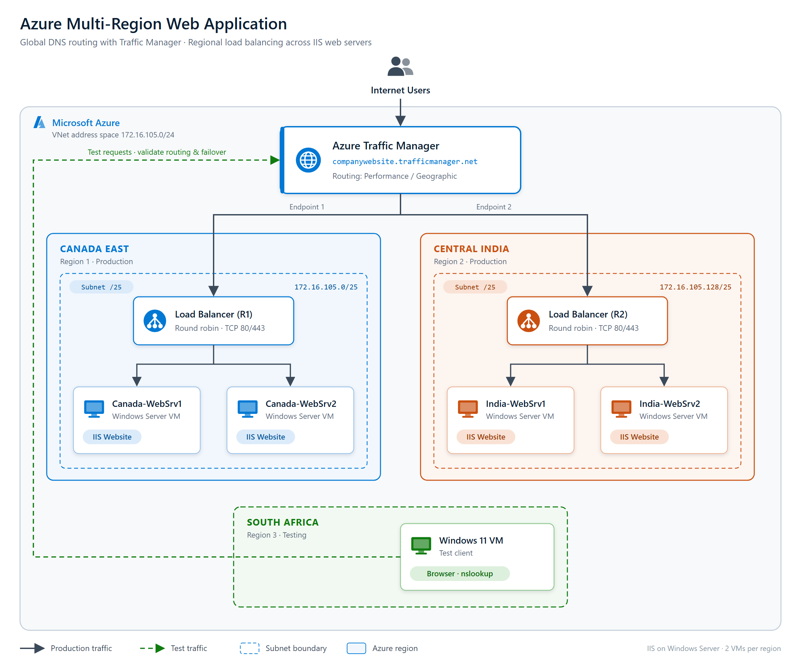

## Highlights

- **2 production regions:** Canada East and Central India
- **4 Windows Server VMs** running IIS, two per region
- **Regional load balancing:** Azure Standard Load Balancer with HTTP health probes
- **Global DNS routing:** Azure Traffic Manager with the Performance routing method
- **Tested from a third region:** a Windows 11 client VM in South Africa North
- **Regional failover verified:** stopping both Canada servers sent all traffic to India

## Network Design

The /24 address space is split between the two regions so the VNets never overlap.

| Region | VNet | Address space | Web subnet |
|---|---|---|---|
| Canada East | AaronKing-VNet-R1 | 172.16.105.0/25 | R1-WebSubnet: 172.16.105.0/26 |
| Central India | AaronKing-VNet-R2 | 172.16.105.128/25 | R2-WebSubnet: 172.16.105.128/26 |

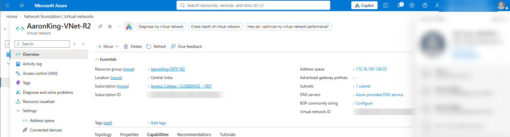

## Components

### Virtual machines

| VM | Region | OS | Size | Role |
|---|---|---|---|---|
| Canada-WebSrv1 | Canada East | Windows Server | Standard_B2s | IIS web server |
| Canada-WebSrv2 | Canada East | Windows Server | Standard_B2s | IIS web server |
| India-WebSrv1 | Central India | Windows Server | Standard_B2s | IIS web server |
| India-WebSrv2 | Central India | Windows Server | Standard_B2s | IIS web server |
| SouthAfrica-TestVM | South Africa North | Windows 11 | Standard_B2s | Test client |

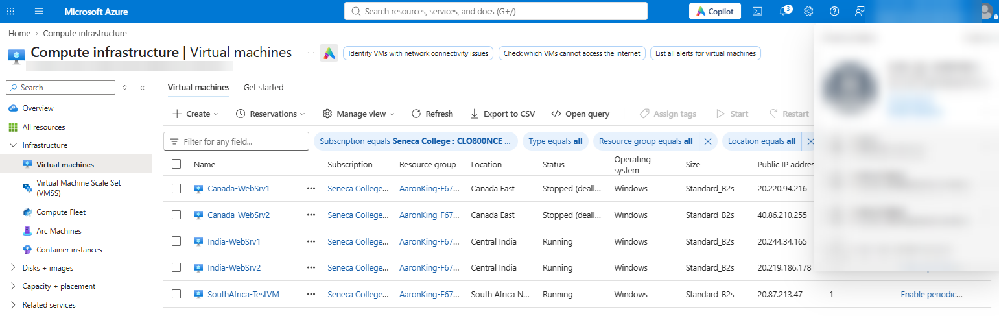

### IIS websites

Each web server hosts a simple page that shows its **region** and **VM name**. That makes it easy to see which server answered a request during testing.

| Canada East | Central India |
|---|---|
| 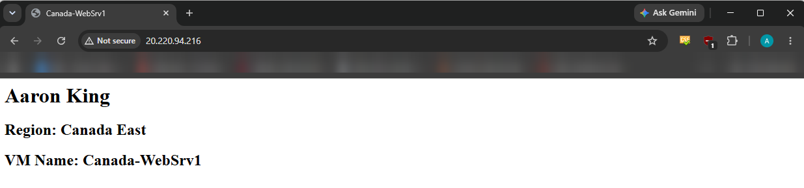 | 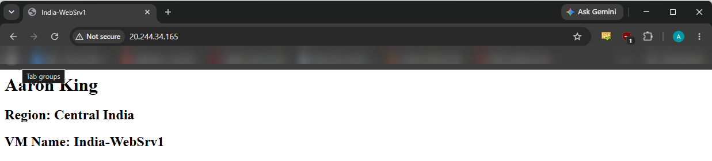 |
| 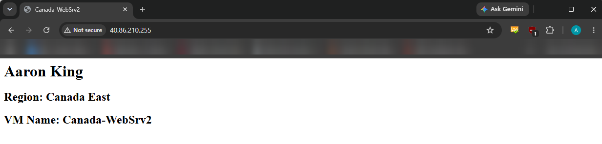 | 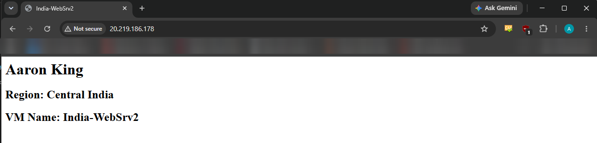 |

### Regional load balancers

Each region has a Standard Azure Load Balancer (Canada-LB and India-LB) with the same configuration:

| Setting | Value |
|---|---|
| SKU / tier | Standard / Regional |
| Backend pool | 2 web servers |
| Health probe | HTTP on port 80 |
| Load balancing rule | TCP port 80 |
| Session persistence | None |

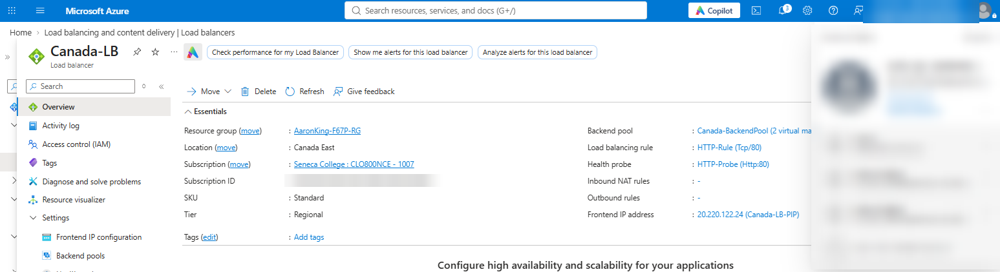
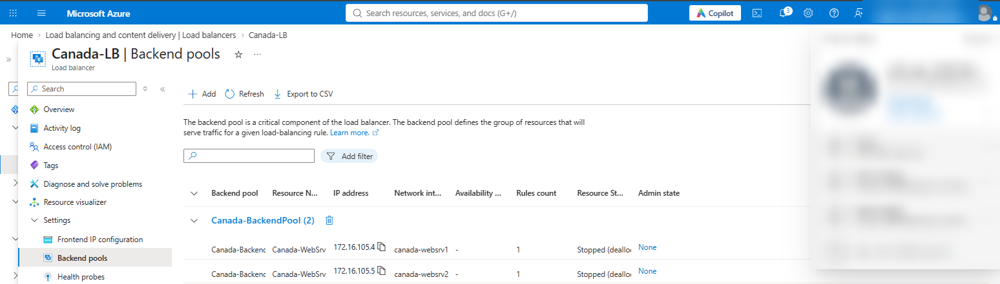

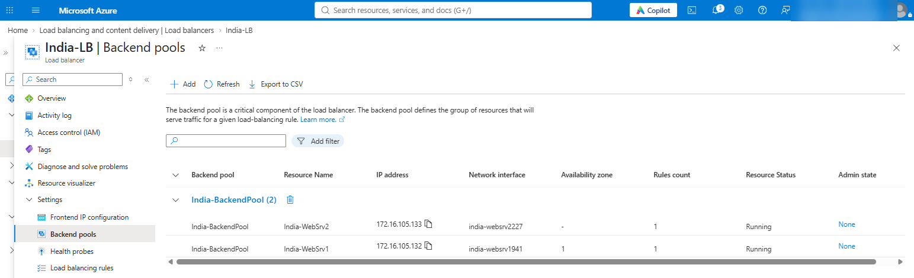

### Traffic Manager

The Traffic Manager profile `aaronking-cl800.trafficmanager.net` has two endpoints, one for each regional load balancer's public IP. It uses **Performance** routing, which sends each user to the region with the lowest latency for them. It also stops sending traffic to an endpoint whose health checks fail.

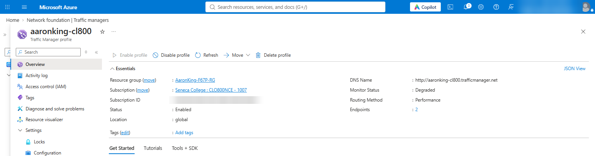

## Testing

### 1. Local test (from Toronto)

Browsing to the Traffic Manager URL from Toronto reached the **Canada East** servers. Two separate browser sessions were answered by Canada-WebSrv1 and Canada-WebSrv2, which shows the load balancer was using both servers.

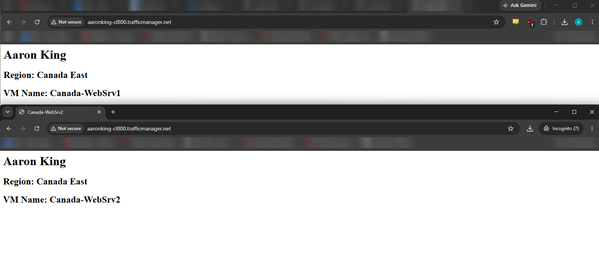

### 2. Remote test (from South Africa)

From the South Africa test VM, the same URL reached the **Central India** servers. That region has lower latency from South Africa, so this confirms Performance routing was working. Both India-WebSrv1 and India-WebSrv2 responded.

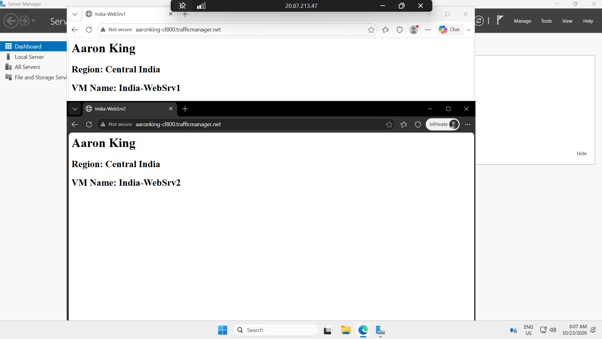

### 3. Regional failover

Both Canada East web servers were stopped to simulate a regional outage. Traffic Manager's health checks marked the Canada endpoint unhealthy, and its profile status changed to *Degraded*. Requests from Toronto were then served by **Central India**, with no change to DNS or client settings.

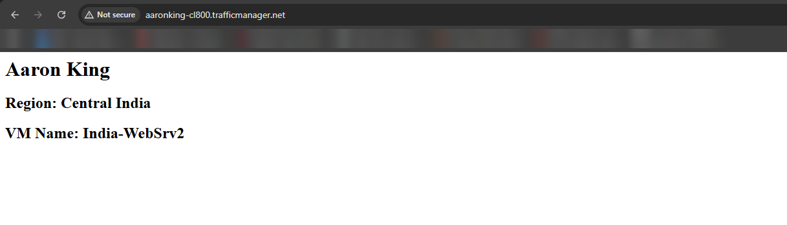

## Challenges and Lessons Learned

- **Multi-region networking:** splitting one /24 into non-overlapping VNets and subnets for each region
- **Traffic Manager configuration:** understanding how routing methods and endpoint health checks work together
- **Load balancer validation:** confirming that health probes mark backends healthy before traffic is sent to them
- **Health probe monitoring:** watching probe status change during failover to understand how quickly an outage is detected

## Next Steps

- Rebuild the deployment as infrastructure as code (Terraform or Bicep) so it can be recreated in minutes
- Add HTTPS with a certificate on each load balancer or an Application Gateway
- Replace standalone VMs with Virtual Machine Scale Sets for automatic scaling
- Add Azure Monitor alerts for endpoint health changes

## Note

All Azure resources were deleted after testing. The IP addresses and the Traffic Manager DNS name in the screenshots no longer resolve. Account details and subscription IDs have been blurred.
